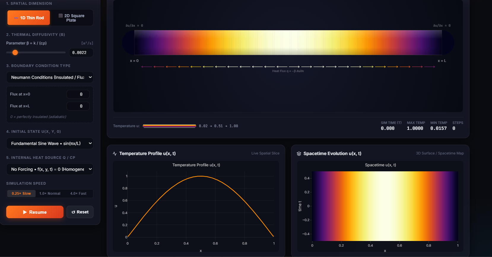
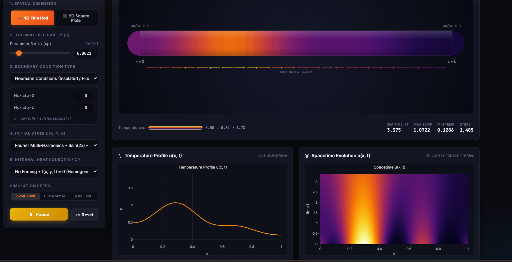
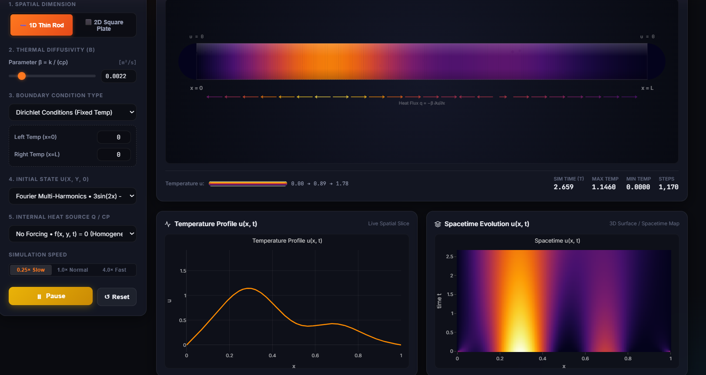
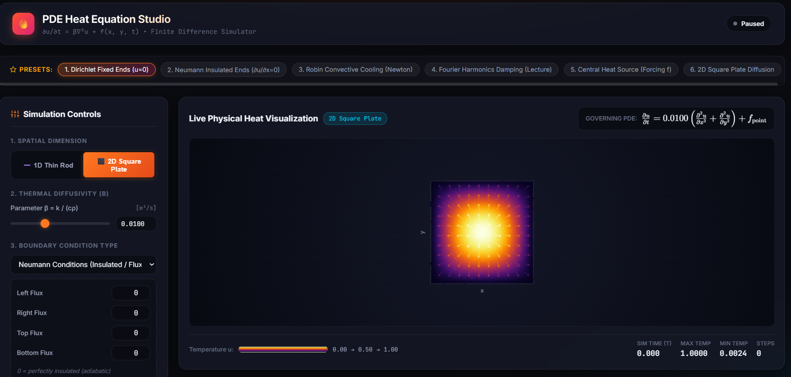
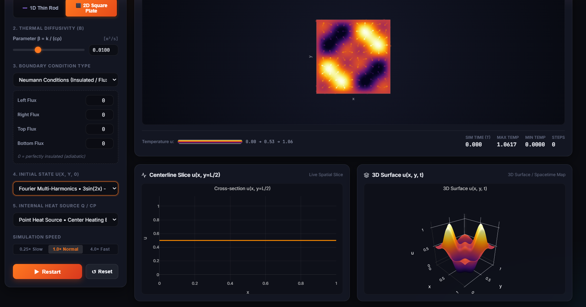
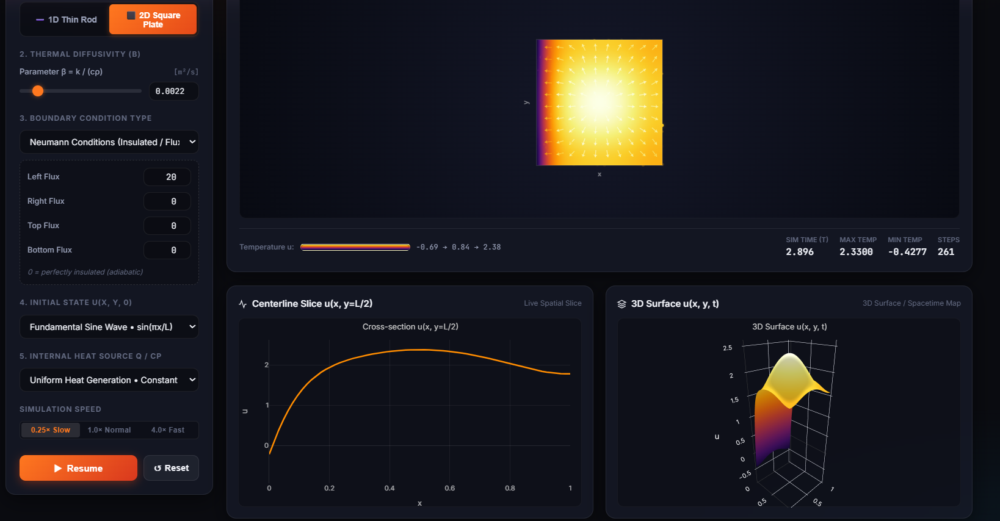

# 🔥 Interactive PDE Heat Equation Studio

An interactive, illustrative learning environment and visualizer for solving and exploring the **Heat Equation** (parabolic Partial Differential Equations) in 1D and 2D. Built with vanilla JavaScript, HTML5 Canvas, MathML, KaTeX, and Plotly.js

Developed for **MTH G202: Special Functions and Partial Differential Equations** at Cairo University, Faculty of Engineering, under the supervision of **Dr. Ahmed Sayed AbdelSamea**.

---

## 📸 Visual Simulation Gallery

Below is a structured walkthrough of the key simulation modes, physical phenomena, and numerical behaviors demonstrated by the studio:

---

### 1. 1D Thin Rod Dynamics

#### A. Insulated Neumann Boundaries ($\frac{\partial u}{\partial x} = 0$) & Spacetime Evolution
Shows a fundamental sinusoidal initial temperature distribution diffusing inside an insulated rod. With zero boundary heat flux, the total thermal energy in the rod is strictly conserved, and the heat smooths out until reaching a uniform equilibrium average. The live **Spacetime Evolution** map traces the decay over continuous time $t$.



---

#### B. Fourier Harmonic Damping (Lecture Example: $3\sin(2x) - 6\sin(5x)$)
Demonstrating the core consequence of the Separation of Variables analytical solution: higher spatial frequencies ($5\pi$) decay exponentially at rate $\propto n^2 = 25$, vanishing almost immediately, while lower frequencies ($2\pi$, rate $\propto 4$) persist much longer.

| Insulated Neumann Boundaries ($\frac{\partial u}{\partial x} = 0$) | Fixed Cold Dirichlet Boundaries ($u(0)=u(L)=0$) |
|:---:|:---:|
|  |  |
| *Heat redistributes internally without leaving the rod.* | *Heat rapidly escapes through both cold ends to $u=0$.* |

---

### 2. 2D Square Plate Diffusion

#### A. Central Point Heat Source (Internal Forcing $f_{\text{point}}$)
Simulates a localized heating element placed at the plate's center. The live vector field shows heat flux vectors $\mathbf{q} = -\beta \nabla u$ radiating outward in all directions toward the cooler boundaries.



---

#### B. 2D Multi-Harmonic State with Live 3D Surface Evolution
Displays complex multi-modal 2D temperature distributions with dual real-time Plotly diagnostics: a **Centerline Spatial Slice** $u(x, y=L/2)$ and an interactive **3D Surface Plot** $u(x, y, t)$.



---

#### C. Active Boundary Flux Injection & Dynamic Scale Expansion
Testing active non-zero boundary flux conditions (`Left Flux = 20`). Thermal energy continuously enters through the left boundary, causing local temperatures to climb past $u = 2.33$. The visualizer's **dynamic auto-scaling** seamlessly expands the vertical limits on both the 2D cross-section and the 3D surface plot to keep the entire waveform visible without clipping.



---

## 🚀 Key Features

- **Multi-Dimensional Physics**:
  - **1D Thin Rod**: High-resolution 200-grid discretization with rounded end caps and gradient reflections.
  - **2D Square Plate**: Real-time grid diffusion with 2D heat flux vectors and floating thermal particles.
- **Three Fundamental Boundary Conditions**:
  - **Dirichlet (Fixed Temperatures)**: Prescribed boundary temperatures $u(0,t)=T_0$ and $u(L,t)=T_L$.
  - **Neumann (Insulated / Arbitrary Flux)**: Prescribed heat flux $\frac{\partial u}{\partial n}$ on all edges (0 for adiabatic insulation, or positive/negative for active heating/cooling).
  - **Robin (Newton's Law of Cooling)**: Convective heat exchange with ambient medium: $-k\frac{\partial u}{\partial n} = h(u - T_\infty)$.
- **Diverse Initial States**:
  - Fundamental Sine wave $\sin(\pi x/L)$
  - Fourier Multi-Harmonics $3\sin(2x) - 6\sin(5x)$ (demonstrating why high frequencies decay exponentially faster)
  - Gaussian thermal pulse $\exp(-60(x - L/2)^2)$
  - Heaviside step discontinuity (cold half / hot half)
  - Triangular peak (sharp gradient smoothing)
- **Internal Heat Generation (Forcing)**:
  - Point heating element at domain center ($Q_{\text{center}}$)
  - Uniform Joulean volumetric heat generation ($Q_0$)
- **Live Convergence & Steady-State Detection**:
  - Automatically tracks maximum derivative $\frac{\partial u}{\partial t}$.
  - Gracefully alerts when equilibrium is reached ($\frac{\partial u}{\partial t} < 10^{-7}$) with a 1-click **Replay** feature.
- **Dynamic Auto-Scaling**:
  - Automatically adjusts plot limits and colormaps when internal generation or high fluxes push temperatures beyond $[0, 1]$.
- **One-Click Lecture Presets**:
  - Instant setups for Dirichlet zero ends, insulated Neumann, Robin cooling, Fourier harmonic damping, central heat sources, and 2D square plate diffusion.

---

## 📐 Mathematical Formulation

### 1. The Governing Initial-Boundary Value Problem (IBVP)

$$\frac{\partial u}{\partial t} = \beta \nabla^2 u + \frac{Q(x, y, t)}{c\rho}$$

Where:
- $u(x, y, t)$ is the temperature distribution.
- $\beta = \frac{k}{c\rho}$ is the **thermal diffusivity** of the material:
  - $k$: Thermal conductivity
  - $c$: Specific heat capacity
  - $\rho$: Mass density
- $Q(x, y, t)$: Volumetric internal heat source.

### 2. Numerical Discretization (Explicit Finite Difference)

The spatial second derivatives are discretized using second-order central differences:

$$\frac{\partial^2 u}{\partial x^2} \approx \frac{u_{i+1, j} - 2u_{i, j} + u_{i-1, j}}{\Delta x^2}$$

Time integration uses the Forward Euler scheme:

$$u_{i, j}^{n+1} = u_{i, j}^n + \Delta t \left[ \beta \left( \frac{u_{i+1, j}^n - 2u_{i, j}^n + u_{i-1, j}^n}{\Delta x^2} + \frac{u_{i, j+1}^n - 2u_{i, j}^n + u_{i, j-1}^n}{\Delta y^2} \right) + \frac{Q_{i, j}^n}{c\rho} \right]$$

### 3. CFL Stability Criterion

To guarantee numerical stability and prevent oscillations or divergence:

- **1D**: $\Delta t \le \frac{\Delta x^2}{2\beta}$
- **2D**: $\Delta t \le \frac{\min(\Delta x, \Delta y)^2}{4\beta}$

The simulation dynamically computes and enforces this step using a safe CFL factor ($0.4$).

---

## 💻 How to Run Locally

This project requires **no external dependencies, build tools, or backend servers**. It runs natively in any modern web browser.

### Option 1: Direct File Opening
Double-click [index.html](index.html) or open it with your favorite browser (Chrome, Edge, Firefox, Safari).

### Option 2: Local Static Server
Using Python (3.x):
```bash
python -m http.server 8080
```
Then visit:
```
http://localhost:8080
```

### Option 3: Deploy to GitHub Pages
1. Push this repository to GitHub.
2. In your repository settings, go to **Pages**.
3. Select the `main` branch as the source and click **Save**.
4. The simulation will be live on `https://<username>.github.io/<repo-name>/`.

---

## 📁 Repository Structure

```
.
├── index.html            # Main HTML interface, MathML theory cards, controls
├── css/
│   └── style.css         # Modern dark-mode scientific UI, glassmorphism styling
├── js/
│   ├── solver.js         # Finite difference PDE solver (1D/2D, Dirichlet/Neumann/Robin, CFL)
│   ├── renderer.js       # HTML5 Canvas thermal renderer with heat flux arrows and particles
│   └── app.js            # UI controller, Plotly graph bindings, presets, dynamic scaling
├── assets/
│   └── images/           # High-resolution simulation screenshots for documentation
└── README.md             # Project documentation and theoretical background
```

---

## 👨‍🏫 Credits & Acknowledgments

- **Course**: MTH G202 — Special Functions and Partial Differential Equations
- **Supervision**: Dr. Ahmed Sayed AbdelSamea (Cairo University, Faculty of Engineering)
- **Author**: Eng. Ziad A. Abdelgawad
- **Institution**: Cairo University — Faculty of Engineering
